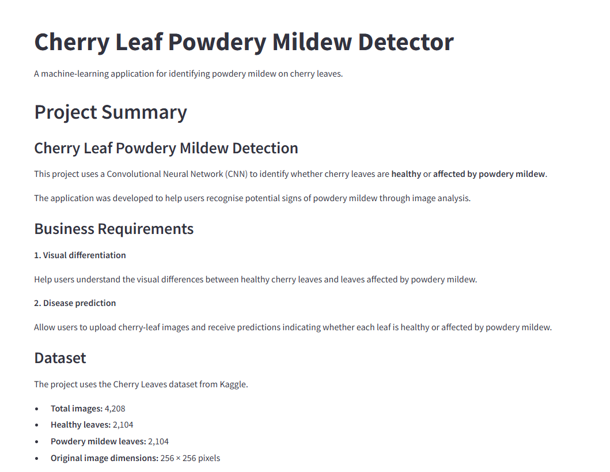
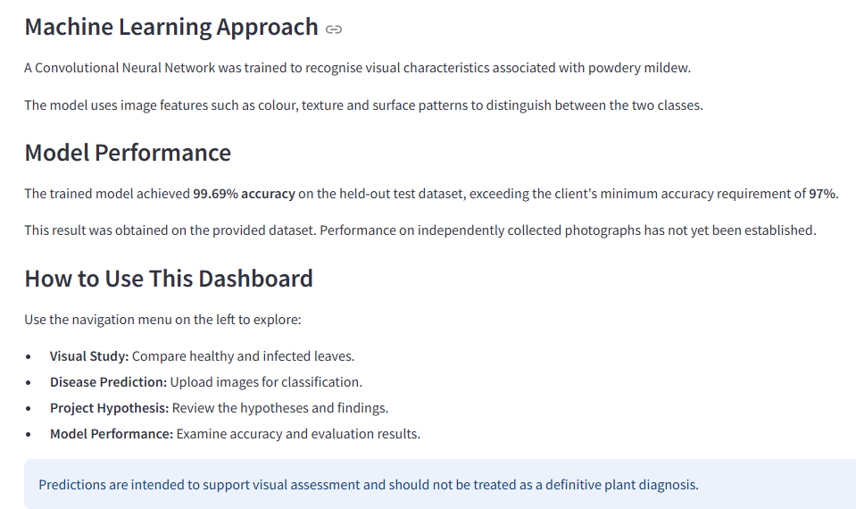
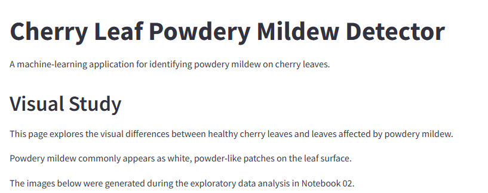
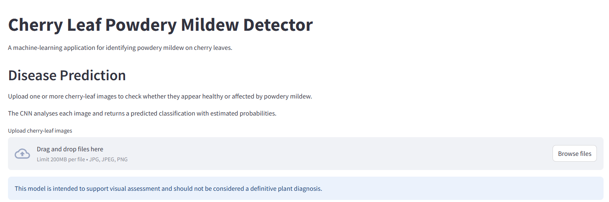
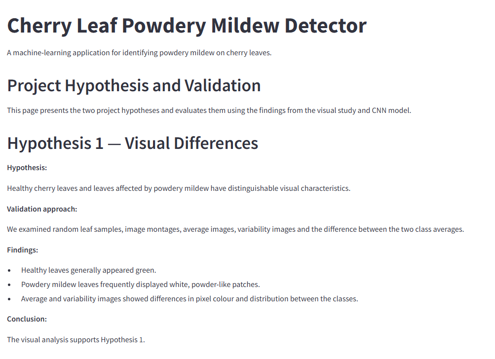
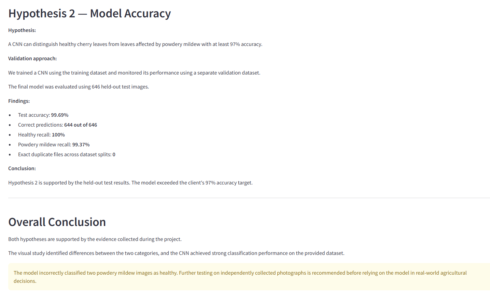
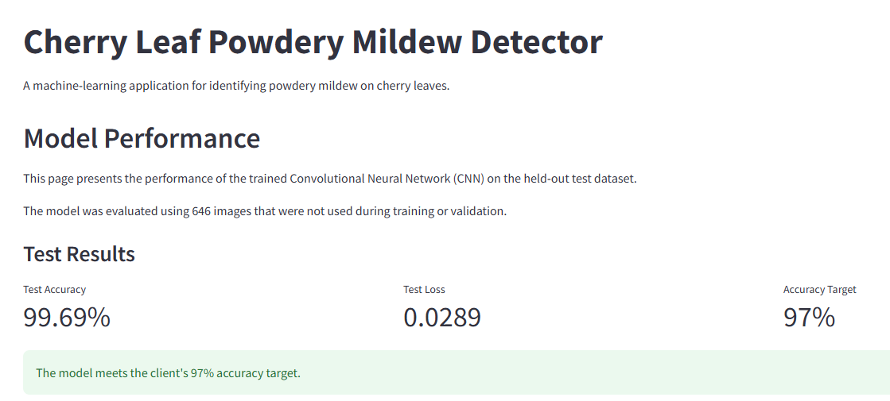
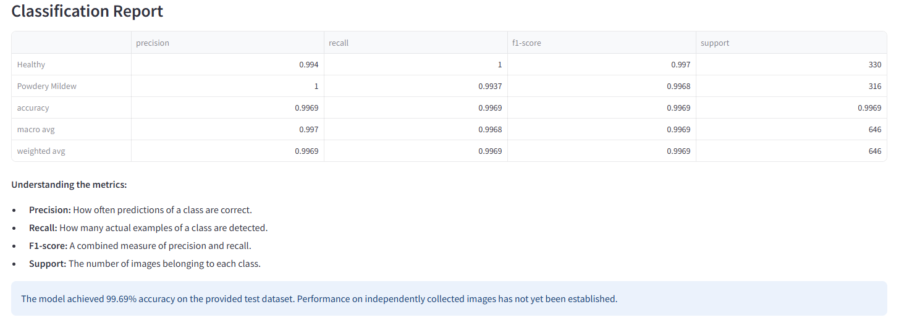

# Cherry Leaf Powdery Mildew Detector

## Project Overview

The **Cherry Leaf Powdery Mildew Detector** is a machine-learning application designed to identify whether a cherry leaf is healthy or affected by powdery mildew. It responds to a business challenge faced by Farmy & Foods, whose cherry plantations require regular disease inspections.

A Convolutional Neural Network (CNN) was trained on labelled cherry-leaf images and integrated into a Streamlit dashboard. Users can explore visual differences, upload images for classification, review evaluation results and download predictions.

The model achieved **99.69% accuracy on 646 held-out test images**, exceeding the client's **97%** target.

**Project status:** Model development, evaluation, dashboard development and Heroku deployment completed.

## Live Application

**[Launch the Live Application](https://mildew-detection-fd7fc4092562.herokuapp.com/)**

The dashboard has five pages:

1. **Project Summary:** Project background, business requirements and approach.
2. **Visual Study:** Average images, variability images and visual differences between classes.
3. **Disease Prediction:** Multiple image uploads, CNN predictions, class probabilities and CSV download.
4. **Project Hypothesis:** Hypotheses, validation methods and conclusions.
5. **Model Performance:** Test accuracy, loss, confusion matrix and classification report.

The application demonstrates image classification; it is not a substitute for professional agricultural diagnosis.

## Business Requirements

Farmy & Foods operates cherry plantations across multiple farms and has experienced powdery mildew in its crops. The project brief describes a manual inspection process taking approximately 30 minutes per tree, with about one additional minute to apply treatment where required. With thousands of trees, manual inspection is difficult to scale.

### Business Requirement 1 — Visual Differentiation

The client wants to distinguish healthy cherry leaves from leaves affected by powdery mildew. The project examines sample images and montages, generates average and pixel-variability images, and presents the differences in the dashboard.

### Business Requirement 2 — Disease Prediction

The client wants to predict whether a cherry leaf is healthy or affected by powdery mildew from an image. The project prepares labelled datasets, trains and evaluates a CNN against a **97% accuracy target**, and makes predictions available through the dashboard.

## Project Hypotheses and Validation

### Hypothesis 1 — Visual Differences

**Hypothesis:** Healthy cherry leaves and leaves affected by powdery mildew have distinguishable visual characteristics, particularly in colour and surface texture.

**Validation:** Random samples, image montages, average images, variability images and average-image differences were examined. Healthy leaves generally appeared green, while powdery mildew leaves frequently displayed white, powder-like patches. Differences in pixel colour and distribution were also visible.

**Conclusion:** The visual study supports Hypothesis 1.

### Hypothesis 2 — Model Accuracy

**Hypothesis:** A CNN trained on labelled cherry-leaf images can achieve at least 97% accuracy on a held-out test dataset.

**Validation:** The CNN was trained on the training split, monitored on the validation split and evaluated on **646 held-out test images**.

- Test accuracy: **99.69%**
- Correct predictions: **644 of 646**
- Healthy recall: **100%**
- Powdery mildew recall: **99.37%**

**Conclusion:** Hypothesis 2 is supported by the held-out test results. Performance on independently collected images remains unverified.

## Dataset

The cherry-leaf dataset was distributed through Kaggle as part of the Code Institute machine-learning project. It contains **4,208 images**, originally **256 × 256 pixels**, divided equally between two classes.

| Class | Images |
|---|---:|
| Healthy | 2,104 |
| Powdery mildew | 2,104 |
| **Total** | **4,208** |

The dataset includes rotated and flipped variations, requiring care to reduce leakage between dataset splits.

### Dataset Split

| Dataset | Healthy | Powdery mildew | Total |
|---|---:|---:|---:|
| Training | 1,464 | 1,472 | 2,936 |
| Validation | 310 | 316 | 626 |
| Testing | 330 | 316 | 646 |
| **Total** | **2,104** | **2,104** | **4,208** |

This is approximately a 70% / 15% / 15% split by image count. Original and processed datasets are excluded from version control.

## Machine-Learning Workflow

The project uses five Jupyter notebooks.

### 1. Data Collection

**Notebook:** `01 data_collection.ipynb`

- Downloaded the Kaggle dataset.
- Verified the two image categories, image count and dimensions.
- Inspected the extracted directory structure.
- Kept Kaggle credentials outside version control.

### 2. Data Visualisation

**Notebook:** `02_data_visualisation.ipynb`

- Displayed random samples and image montages.
- Generated average images and pixel-variability images for both classes.
- Compared the two class averages.
- Saved the following dashboard assets:

```text
outputs/visual_study/
├── healthy_average.png
├── mildew_average.png
├── healthy_variability.png
├── mildew_variability.png
└── average_difference.png
```

### 3. Data Cleaning and Preparation

**Notebook:** `03_data_cleaning.ipynb`

- Checked all 4,208 images for corruption; **none were corrupt**.
- Identified **1,847 source-image groups** using filename information.
- Kept known augmented versions of the same source image in one split.
- Created training, validation and test datasets.
- Recorded split assignments in a local manifest excluded from Git.

### 4. Model Training

**Notebook:** `04_model_training.ipynb`

A CNN was developed using TensorFlow/Keras with:

- **100 × 100** RGB input images (resized during data loading and inference).
- A built-in pixel-value rescaling layer.
- Three convolutional and max-pooling stages.
- A dense layer, dropout and sigmoid binary-classification output.

| Setting | Value |
|---|---|
| Optimiser | Adam |
| Learning rate | 0.001 |
| Loss | Binary crossentropy |
| Metric | Accuracy |
| Early stopping | Validation loss; patience 3 |

Training ended after **eight epochs**, with the best validation-loss weights restored from epoch five.

Saved outputs:

- `outputs/models/cherry_leaf_cnn.keras`
- `outputs/models/training_history.csv`

The saved model performs its own pixel-value rescaling. Uploaded images must **not** be normalised a second time.

### 5. Model Evaluation

**Notebook:** `05_model_evaluation.ipynb`

The final model was evaluated on **646 held-out images**, not used during training or validation.

| Metric | Result |
|---|---:|
| Test accuracy | 99.69% |
| Test loss | 0.0289 |
| Correct classifications | 644 |
| Incorrect classifications | 2 |
| Healthy precision | 99.40% |
| Healthy recall | 100.00% |
| Healthy F1-score | 99.70% |
| Powdery mildew precision | 100.00% |
| Powdery mildew recall | 99.37% |
| Powdery mildew F1-score | 99.68% |

#### Confusion Matrix

| Actual class | Predicted healthy | Predicted powdery mildew |
|---|---:|---:|
| Healthy | 330 | 0 |
| Powdery mildew | 2 | 314 |

The two errors were **false negatives**: diseased leaves classified as healthy. This matters because missed disease predictions could delay action.

The accuracy exceeded the 97% target by approximately **2.69 percentage points**. This result does not guarantee the same accuracy on new photographs collected under different conditions.

### Data Leakage Checks

- Related images were grouped using filename-derived source identifiers.
- Known flipped and rotated variations remained in the same split.
- No identified source-image groups overlapped across splits.
- SHA-256 hashes identified **4,208 unique image files**.
- No byte-for-byte duplicates were found across dataset splits.

These measures reduce leakage risk but cannot rule out every visually equivalent image saved with different transformations or compression.

## Streamlit Dashboard

### Project Summary

Introduces the project, business requirements, dataset and approach.

### Visual Study

Displays average images, variability images and visual comparisons.

### Disease Prediction

Users can upload JPG, JPEG or PNG files, process multiple images, view predicted classes and probabilities, and download a CSV of results. The sigmoid classification threshold is **0.5**.

### Project Hypothesis

Explains the two hypotheses, validation methods and conclusions.

### Model Performance

Displays test accuracy, loss, target accuracy, confusion matrix and classification report. The dashboard reads saved model and evaluation files rather than recomputing test metrics on each visit.

## Dashboard Screenshots

### Project Summary





### Visual Study



### Disease Prediction



### Project Hypothesis





### Model Performance





## Technologies Used

| Technology | Purpose |
|---|---|
| Python | Main programming language |
| Jupyter Notebook | Exploration, preparation, training and evaluation |
| NumPy | Image arrays and numerical calculations |
| Pandas | Dataset records, reports and CSV results |
| Matplotlib | Charts and visualisations |
| Seaborn | Confusion matrix visualisation |
| Pillow | Image loading and resizing |
| Scikit-learn | Dataset splitting and evaluation metrics |
| TensorFlow / Keras | CNN training, saving and inference |
| Streamlit | Interactive dashboard |
| PyArrow | Streamlit DataFrame support |
| Git and GitHub | Version control and repository hosting |
| GitHub Codespaces | Development environment |
| Heroku | Live deployment |

## Repository Structure

```text
.
├── app.py
├── jupyter_notebooks/
│   ├── 01 data_collection.ipynb
│   ├── 02_data_visualisation.ipynb
│   ├── 03_data_cleaning.ipynb
│   ├── 04_model_training.ipynb
│   └── 05_model_evaluation.ipynb
├── outputs/
│   ├── visual_study/
│   ├── models/
│   │   ├── cherry_leaf_cnn.keras
│   │   └── training_history.csv
│   └── evaluation/
│       ├── test_metrics.json
│       ├── classification_report.csv
│       └── confusion_matrix.csv
├── docs/
│   └── screenshots/
├── data/
│   ├── raw/
│   └── processed/
├── requirements.txt
├── requirements-dev.txt
├── Procfile
├── setup.sh
├── .python-version
├── .slugignore
├── .gitignore
└── README.md
```

The `data/` folders contain local working datasets and are excluded from Git. The dashboard requires the trained model, evaluation outputs and visual-study images.

## Running the Project Locally

The project was developed using **Python 3.12** in GitHub Codespaces.

1. Clone the repository and navigate to its root.
2. Create and activate a virtual environment:

   ```bash
   python -m venv .venv
   source .venv/bin/activate
   ```

3. Install the dashboard dependencies:

   ```bash
   python -m pip install -r requirements.txt
   ```

4. For notebook development, install the additional dependencies:

   ```bash
   python -m pip install -r requirements-dev.txt
   ```

5. Start Streamlit:

   ```bash
   python -m streamlit run app.py
   ```

6. Open the address shown in the terminal. In Codespaces, use the **Ports** tab to open the forwarded URL.

To reproduce the complete data collection and training workflow, obtain authorised access to the Kaggle dataset and run the notebooks in numerical order. Do not commit credentials or original client images.

## Testing

Testing covered dataset preparation, model evaluation, dashboard behaviour and deployment.

### Data Validation

| Test | Result | Status |
|---|---|---|
| Image count | 4,208 images | Passed |
| Class categories | Healthy and powdery mildew | Passed |
| Corrupt image check | None found | Passed |
| Dataset split totals | 2,936 train / 626 validation / 646 test | Passed |
| Source-image group overlap | None identified across splits | Passed |
| Exact duplicate file check | None across splits | Passed |

### Model Evaluation

| Test | Target | Actual result | Status |
|---|---|---|---|
| Test accuracy | At least 97% | 99.69% | Passed |
| Healthy classification | Correctly identify healthy leaves | 330/330 | Passed |
| Powdery mildew classification | Correctly identify diseased leaves | 314/316 | Passed with limitation |
| Held-out evaluation | Separate test data | 646 images | Passed |

### Dashboard Functionality

| Feature | Expected behaviour | Status |
|---|---|---|
| Project Summary | Project information displays | Passed |
| Visual Study | Visual-study images display | Passed |
| Disease Prediction | Uploaded images receive predictions | Passed |
| Multiple uploads | Multiple images can be processed | Passed |
| Probabilities | Class probabilities display | Passed |
| CSV download | Prediction results can be downloaded | Passed |
| Project Hypothesis | Hypotheses and findings display | Passed |
| Model Performance | Metrics, confusion matrix and report display | Passed |
| Navigation | All pages accessible | Passed |
| Local startup | Streamlit launches in Codespaces | Passed |
| Heroku deployment | Live application opens | Passed |

**Testing limitations:** The held-out test images came from the provided dataset. Independent photographs are needed to evaluate real-world generalisation, and the classification probabilities have not been independently calibrated.

## Deployment

### Heroku

**[Open the Deployed Application](https://mildew-detection-fd7fc4092562.herokuapp.com/)**

### Deployment Configuration

| File | Purpose |
|---|---|
| `app.py` | Main dashboard |
| `requirements.txt` | Deployment dependencies |
| `requirements-dev.txt` | Development and notebook dependencies |
| `Procfile` | Heroku web process startup command |
| `setup.sh` | Streamlit server configuration |
| `.python-version` | Python 3.12 specification |
| `.slugignore` | Excludes unnecessary deployment files |

The application loads `outputs/models/cherry_leaf_cnn.keras` and reads visual-study and evaluation assets from `outputs/`. Original and processed images are not required for inference.

### Deployment Process

1. Prepared the dashboard and saved model artifacts.
2. Separated dashboard and notebook dependencies.
3. Configured Heroku startup through `Procfile` and `setup.sh`.
4. Configured Streamlit to use the platform-assigned port.
5. Excluded unnecessary files using `.slugignore`.
6. Authenticated with Heroku using browser-based login and MFA.
7. Deployed the application and opened the live dashboard.
8. Checked the application and model-performance pages.

During testing, a PyArrow/NumPy compatibility issue was resolved by pinning **`pyarrow==17.0.0`**. Confirm this dependency fix has also been deployed to Heroku. The application uses CPU-based TensorFlow inference and does not require a GPU.

## Bugs, Issues and Resolutions

### 1. Python Virtual Environment and Package Installation

**Issue:** Codespaces had `PIP_USER=yes`, which conflicted with installing packages in the virtual environment.

**Resolution:** Ran `unset PIP_USER`, activated `.venv` and selected the correct Jupyter kernel.

### 2. Kaggle Authentication and Dataset Paths

**Issue:** Kaggle authentication required configuration, and the extracted dataset contained an extra nested directory.

**Resolution:** Stored credentials privately with restricted permissions and updated notebook paths after inspecting the folders.

### 3. Image File Extension Differences

**Issue:** Some images had uppercase `.JPG` extensions and could be missed by lowercase-only filters.

**Resolution:** Normalised extensions with `.suffix.lower()`, ensuring all 4,208 images were included.

### 4. Jupyter Syntax and Working Directory

**Issue:** An incomplete `try` block caused an `IndentationError`, and working-directory changes affected file paths.

**Resolution:** Corrected the code and verified the working directory before file operations.

### 5. Kernel Crash During Image Analysis

**Issue:** Loading many full-resolution images simultaneously exhausted notebook memory.

**Resolution:** Rewrote mean and variance calculations to process images incrementally.

### 6. Dataset Splitting and Augmented Images

**Issue:** Random splitting could place augmented versions of the same photograph in different splits. An early attempt also produced incorrect group counts.

**Resolution:** Split 1,847 filename-derived source-image groups without overlap and checked exact duplicates with SHA-256.

### 7. TensorFlow Warnings

**Issue:** TensorFlow displayed dataset shuffling and `OUT_OF_RANGE: End of sequence` messages.

**Resolution:** Reviewed the messages; training and evaluation completed successfully without requiring changes.

### 8. Saved Keras Model Not Displaying in VS Code

**Issue:** VS Code could not display the `.keras` model as text.

**Resolution:** Treated it as a binary model artifact and verified loading through TensorFlow/Keras.

### 9. PyArrow and NumPy Compatibility

**Issue:** The classification report failed to display with:

```text
ImportError: pyarrow requires NumPy 2.0 or newer, found 1.26.1
```

**Resolution:** Pinned `pyarrow==17.0.0`, compatible with the project's NumPy version, and retested the report.

### 10. Streamlit Port Already in Use

**Issue:** Port 8501 was occupied by an earlier or suspended Streamlit process.

**Resolution:** Identified processes with `ps aux | grep '[s]treamlit'`, stopped the relevant process and reopened the dashboard through Codespaces port forwarding.

### 11. Streamlit CORS Warning

**Issue:** Disabling CORS while XSRF protection was enabled caused a configuration warning.

**Resolution:** Removed the conflicting CORS setting from `setup.sh` and retained Streamlit's default security protections.

### Lessons Learned

The project highlighted the importance of environment management, file-path validation, memory-efficient image processing, leakage-aware splitting, dependency compatibility and end-to-end deployment testing.

## Known Limitations

- Evaluation used images from the provided dataset, not independently collected photographs.
- Augmented images complicate assessment of generalisation.
- Exact-file hashing cannot detect all transformed or visually equivalent images.
- Two powdery mildew leaves were incorrectly classified as healthy.
- Model probabilities have not been independently calibrated.
- Performance under different lighting, camera and environmental conditions is unknown.
- The classifier recognises only two classes and cannot diagnose other cherry-leaf diseases.
- Predictions should not be the sole basis for agricultural treatment decisions.

## Future Improvements

- Evaluate on independently collected cherry-leaf photographs.
- Investigate the two false-negative predictions.
- Assess probability calibration and alternative thresholds.
- Compare the CNN with transfer-learning approaches.
- Add other disease categories.
- Test robustness under varying lighting and image quality.
- Explore integration with wider agricultural monitoring systems.

## Main Data Analysis and Machine Learning Libraries

- **NumPy:** Numerical arrays, image preprocessing and pixel-level calculations.
- **Pandas:** Data records, evaluation reports and downloadable results.
- **Matplotlib and Seaborn:** Image visualisations, charts and confusion matrix.
- **Pillow:** Loading, converting and resizing images.
- **Scikit-learn:** Dataset splitting and classification metrics.
- **TensorFlow and Keras:** CNN training, saving, loading and inference.
- **Streamlit:** Interactive web application.
- **PyArrow:** DataFrame display support.

## Credits

### Dataset and Project Brief

The project was developed using the Code Institute machine-learning project framework and the cherry-leaf dataset distributed through Kaggle.

### Documentation and Development Resources

Documentation for Python, TensorFlow, Keras, Streamlit, NumPy, Pandas, Matplotlib, Seaborn, Pillow and Scikit-learn supported development. Add specific links for any tutorials, repositories or external code actually used.

### AI Assistance

AI assistance was used for code explanations, debugging, documentation drafting and deployment troubleshooting. The model training, evaluation and application functionality were tested within the project environment.